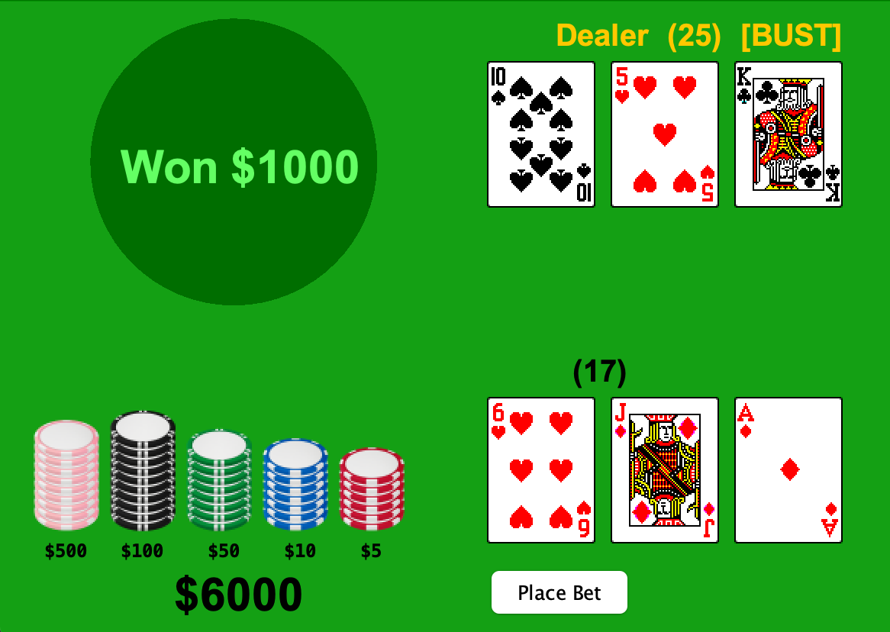

# Blackjack

A desktop Blackjack game built in Java with Swing, featuring a graphical table, betting, player actions, and dealer behavior.

**Author:** Pranav Khatri

## Demo

Demo: https://youtu.be/pA9qMdQO8QA?si=VOu0POVx-AEfTEps

## Highlights

- Standard 52-card deck and deterministic shuffle support
- Blackjack game model for player and dealer hands
- Hit, stay, bust, and dealer-turn logic
- Chip-based betting interface
- Java Swing graphical interface
- JUnit 4 tests for core deck and game behavior

## Academic context

Developed at the University of Maryland for **CMSC132: Object-Oriented Programming II** during the **Summer 2024** session, with **Professor Fawzi Emad**.

## Source code

The complete implementation is maintained in a separate private repository and can be shared with hiring recruiters privately upon request.

## Course policy

The source code remains private in accordance with the course policy. Please do not redistribute or reuse the implementation for coursework.
